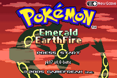
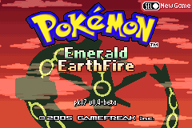

# Emerald Earth Fire

Emerald Earth Fire is a Pokémon Emerald decompilation ROM hack based on RHH's
[pokeemerald-expansion](https://github.com/rh-hideout/pokeemerald-expansion) 1.17.0. The intended adventure covers Hoenn's eight badges and
Elite Four, followed by Kanto's eight badges and Elite Four.

The Emerald target contains the cross-region integration: a post-Hoenn-League crossing
from Lilycove to Vermilion, a Kanto starter gift from Professor Oak, separate regional
badge flags, and access to the Sevii Islands. The Emerald ROM builds successfully,
and focused save, trainer-data, and progression tests pass headlessly. Hoenn and Kanto
use distinct trainer IDs and defeat records, separate from story flags. Full in-game progression remains unverified; see the cleanup review.

## Starter Pokémon

Professor Birch offers three starters from different generations when you begin in Hoenn.

| Type | Hoenn starter | Debut generation |
| --- | --- | --- |
| Grass | Sprigatito | IX |
| Fire | Chimchar | IV |
| Water | Sobble | VIII |

Later, Professor Oak's gift in Vermilion City offers Bulbasaur, Charmander, or Squirtle.

## New game conveniences

- DexNav appears in the Start menu once Professor Birch gives you the Pokédex.
- A new game starts with **35,000 Pokédollars**.
- Your bedroom PC starts stocked with **1 Potion, 999 Rare Candies, 999 Master Balls,
  300 PP Max, 1 Exp. Share, and 1 Dowsing Machine**.

## v0.4-beta title screen




## Project documentation

- [Emerald Earth Fire v0.4-beta changelog](docs/changelogs/earth-fire-v0.4-beta.md)
- [Cleanup review and verification priorities](docs/project_review.md)
- [Kanto integration notes and known limitations](KANTO_IN_EMERALD.md)
- [Build environment setup](INSTALL.md)

## Building this project

After setting up the toolchain described in `INSTALL.md`, run these commands from the
repository root in your build shell (for example, WSL):

```sh
make                  # Emerald.gba: the two-region adventure
make map-tree-check   # Check map data and references
```

The alternative `make firered` and `make leafgreen` targets produce `EmeraldFire.gba`
and `EmeraldEarth.gba`, respectively. They select the FRLG map build; they are not the
two-region Emerald target.

Current 16-badge Emerald saves upgrade automatically to an independent trainer-flag
store while retaining existing story data and save-block offsets. Already-ambiguous
legacy bits are preserved rather than guessed. Saves predating the Kanto variable relocation
are not converted. See [save compatibility](docs/save_compatibility.md), including the
restriction on saving again with an older ROM after upgrading.
